[English](README.md) · **العربية** · [简体中文](README.zh-CN.md) · [繁體中文](README.zh-TW.md) · [Čeština](README.cs.md) · [Français](README.fr.md) · [Deutsch](README.de.md) · [Ελληνικά](README.el.md) · [Bahasa Indonesia](README.id.md) · [Gaeilge](README.ga.md) · [Italiano](README.it.md) · [日本語](README.ja.md) · [한국어](README.ko.md) · [Polski](README.pl.md) · [Română](README.ro.md) · [Русский](README.ru.md) · [Español](README.es.md) · [Українська](README.uk.md) · [اردو](README.ur.md) · [ئۇيغۇرچە](README.ug.md) · [Tiếng Việt](README.vi.md) · [Português](README.pt.md) · [Türkçe](README.tr.md)

<div align="center">


# TrayMixer

**تحكم في مستوى صوت كل مخرجات وتطبيقات من لوحة صغيرة واحدة في علبة النظام Windows 11 أو Linux.**

قم بإيقاف تشغيل إحدى الألعاب مع إبقاء مكالمتك مسموعة، أو قم بالتبديل بين مكبرات الصوت وسماعات الرأس، أو اضبط السطوع وتصفية الضوء الأزرق والتعتيم على Windows.

**لا القياس عن بعد أو الحساب.** مفتوح المصدر تحت Apache 2.0.


<br>


<a href="https://github.com/sailxx/TrayMixer/releases/download/v3.0.2/TrayMixer-Setup.exe"></a>&nbsp;&nbsp;<a href="https://github.com/sailxx/TrayMixer/releases/tag/linux-v3.1.1"></a>&nbsp;&nbsp;<a href="https://github.com/sailxx/TrayMixer/releases/download/v3.0.2/TrayMixer.exe"></a>&nbsp;&nbsp;<a href="https://github.com/sailxx/TrayMixer/releases"></a>

</div>

<br>


<details>
<summary><b>المزيد عن الميزات</b></summary>

### المخرجات وحجم التطبيق

كل مخرج له شريط تمرير خاص به وتحكم في كتم الصوت. انقر فوق اسم الإخراج لتحديده كافتراضي. في Linux، ينطبق هذا على التشغيل الجديد ويظهر كل تدفق للتطبيق بشكل منفصل.

### ضوابط العرض Windows

اضبط السطوع على الشاشات المدعومة، وقم بتدفئة الشاشة باستخدام مرشح الضوء الأزرق، واستخدم برنامج التعتيم من نفس الخلاط. [شاهد لقطة شاشة Windows بالحجم الكامل](assets/readme/screenshot.png).

### ضوابط الدرج

انقر بزر الماوس الأيسر على أيقونة صينية Windows لإظهار الخلاط أو إخفائه ثم انقر عليه بالماوس الأوسط لتبديل كتم الصوت على الإخراج الافتراضي. قم بالتمرير فوق الصف لضبطه بنقطتين، أو انقر فوق أيقونة صف الصوت لكتم الصوت، أو انقر بزر الماوس الأيمن فوق الصف لإخفائه. استعادة الصفوف المخفية من قائمة الدرج. يضعط <kbd>خروج</kbd> أو انقر بالخارج لإغلاق القائمة المنبثقة Windows. تعتمد نقرات علبة Linux على سطح المكتب لديك.

### المظهر وبدء التشغيل والتفضيلات

يستخدم Windows قائمة منبثقة مستديرة. يتبع Linux الألوان الفاتحة والداكنة والألوان المميزة GNOME أو يقدم Charcoal وNord وCatppuccin وLight. يمكنك تمكين بدء التشغيل عند تسجيل الدخول من قائمة الدرج. يتم تخزين التفضيلات محليا.

</details>

<br>



<br>


<br>


<br>


<details>
<summary><b>ثَبَّتَ</b></summary>

### Windows 11 · x64 · v3.0.2

1. تحميل [**TrayMixer-Setup.exe**](https://github.com/sailxx/TrayMixer/releases/download/v3.0.2/TrayMixer-Setup.exe) للمثبت دون اتصال أو [**TrayMixer.exe**](https://github.com/sailxx/TrayMixer/releases/download/v3.0.2/TrayMixer.exe) لتشغيل التطبيق مباشرة.
2. في الإعداد، اختر اللغة الإنجليزية أو الروسية، ومجلد التثبيت وما إذا كنت تريد بدء تشغيل TrayMixer عند تسجيل الدخول. واجهة التطبيق باللغة الإنجليزية. يقوم برنامج الإعداد بإنشاء اختصارات لسطح المكتب وقائمة ابدأ.
3. انقر فوق أيقونة TrayMixer في منطقة الإعلام لفتح الخلاط.

قم بتشغيل برنامج الإعداد مرة أخرى للتحديث أو إعادة التثبيت مع الاحتفاظ بالتفضيلات واختيار التشغيل التلقائي. قم بإزالة التطبيق من خلال Windows **التطبيقات المثبتة**.

الإصدارات غير موقعة، لذلك قد يعرض Windows تحذير SmartScreen. قارن الملف SHA -256 مع الملف [ملاحظات الإصدار Windows](https://github.com/sailxx/TrayMixer/releases/tag/v3.0.2).

للتثبيت غير المراقب دون تشغيل التطبيق، قم بتشغيل `TrayMixer-Setup.exe /S /NOLAUNCH` من مجلد المثبت. تتضمن المفاتيح الاختيارية `/DIR="C:\path\TrayMixer"`, `/NOAUTOSTART` و `/LAUNCH`. من أجل الإزالة غير المراقبة، قم بتشغيل `Uninstall.exe /uninstall /S` من مجلد التثبيت، والذي هو افتراضيا `%LOCALAPPDATA%\TrayMixer`.

### Linux · x86_64 · معاينة v3.1.1

| طَرد | التثبيت أو التشغيل من مجلد التنزيل |
| --- | --- |
| [DEB](https://github.com/sailxx/TrayMixer/releases/download/linux-v3.1.1/TrayMixer_3.1.1_amd64.deb) | `sudo apt install ./TrayMixer_3.1.1_amd64.deb` |
| [RPM](https://github.com/sailxx/TrayMixer/releases/download/linux-v3.1.1/TrayMixer-3.1.1-1.x86_64.rpm) | `sudo dnf install ./TrayMixer-3.1.1-1.x86_64.rpm` |
| [AppImage](https://github.com/sailxx/TrayMixer/releases/download/linux-v3.1.1/TrayMixer-3.1.1-x86_64.AppImage) | `chmod +x TrayMixer-3.1.1-x86_64.AppImage`, ثم `./TrayMixer-3.1.1-x86_64.AppImage` |

تستخدم المعاينة X11 أو XWayland وتحتاج إلى glibc 2.35 + أو PulseAudio 15+ أو PipeWire-Pulse، و `pactl`. يتطلب GNOME دعم AppIndicator لرمز الدرج. يحتاج AppImage إلى مكتبات سطح مكتب النظام ويقبلها `--appimage-extract-and-run` إذا كان FUSE غير متوفر.

انظر [دليل Linux](linux/README.md) لمتطلبات سطح المكتب وسلوك الدرج. قارن تجزئات الحزمة مع [SHA256SUMS](https://github.com/sailxx/TrayMixer/releases/download/linux-v3.1.1/SHA256SUMS).

</details>

<a id="platforms"></a>

<details>
<summary><b>المنصات والحدود المعروفة</b></summary>

| | Windows 11 | معاينة Linux |
| --- | --- | --- |
| صوتي | حجم الجهاز والتطبيق المجمع | الأجهزة وتدفقات التطبيقات الفردية عبر PulseAudio أو PipeWire-Pulse |
| صينية | منطقة الإعلام Windows | يعتمد على مضيف علبة سطح المكتب |
| عرض | السطوع وتصفية الضوء الأزرق والتعتيم | يفتح شاشة سطح المكتب وإعدادات الإضاءة الليلية |
| التفضيلات | `HKCU\Software\TrayMixer` | `$XDG_CONFIG_HOME/traymixer/settings.json` |

يؤثر دعم الشاشة وبرنامج التشغيل على السطوع على Windows. يتم فحص تعبئة Linux وبدء التشغيل على Ubuntu 24.04. لا تزال عمليات تثبيت Fedora وDebian وسلوك علبة GNOME وتوافق الأجهزة بحاجة إلى اختبار سطح المكتب.

</details>

<details>
<summary><b>تطوير</b></summary>

تتم صيانة TrayMixer بواسطة [فلاد (sailxx)](https://github.com/sailxx) تحت [ترخيص أباتشي 2.0](LICENSE).

قم ببناء Windows من نسخة باستخدام . مترجم NET Framework C#.

```cmd
build.cmd
```

قم ببناء Linux باستخدام . NET SDK 10.0 . انظر [دليل البناء والتعبئة Linux](linux/README.md#build-and-verify).

```sh
dotnet build linux/TrayMixer.Linux.csproj -c Release
dotnet run --project linux/tests/TrayMixer.Linux.Tests.csproj -c Release
```

لإعادة إنشاء العمل الفني الإنجليزي README، استخدم الخطوط Golos Text وJetBrains Mono في `tools/readme/.font` كما هو موضح في [build.mjs](tools/readme/build.mjs).

```sh
cd tools/readme
npm ci
node build.mjs --showcase
```

للتحقق من التنزيل، استخدم `Get-FileHash .\TrayMixer-Setup.exe -Algorithm SHA256` في PowerShell ومقارنتها مع [ملاحظات الإصدار Windows](https://github.com/sailxx/TrayMixer/releases/tag/v3.0.2), أو الاستخدام `sha256sum <filename>` على Linux ومقارنتها [SHA256SUMS](https://github.com/sailxx/TrayMixer/releases/download/linux-v3.1.1/SHA256SUMS).

يقوم TrayMixer بتخزين التفضيلات محليًا. يرسل Linux أوامر صوتية إلى خادم PulseAudio أو PipeWire-Pulse الذي تم تكوينه. انظر [سياسة الخصوصية](PRIVACY.md) و [السياسة الأمنية](SECURITY.md). بالنسبة إلى الخطأ القابل للتكرار، قم بتضمين الإصدار OS وسطح المكتب والأجهزة المتأثرة في ملف [مشكلة GitHub](https://github.com/sailxx/TrayMixer/issues).

</details>

---

<div align="center">


قد تصف الترجمات الإصدارات السابقة.

</div>
