[English](README.md) · [العربية](README.ar.md) · [简体中文](README.zh-CN.md) · [繁體中文](README.zh-TW.md) · **Čeština** · [Français](README.fr.md) · [Deutsch](README.de.md) · [Ελληνικά](README.el.md) · [Bahasa Indonesia](README.id.md) · [Gaeilge](README.ga.md) · [Italiano](README.it.md) · [日本語](README.ja.md) · [한국어](README.ko.md) · [Polski](README.pl.md) · [Română](README.ro.md) · [Русский](README.ru.md) · [Español](README.es.md) · [Українська](README.uk.md) · [اردو](README.ur.md) · [ئۇيغۇرچە](README.ug.md) · [Tiếng Việt](README.vi.md) · [Português](README.pt.md) · [Türkçe](README.tr.md)

<div align="center">


# TrayMixer

**Ovládejte hlasitost každého výstupu a aplikace z jednoho malého panelu v systémové liště Windows 11 nebo Linux.**

Vypněte hru a nechte hovor slyšet, přepínejte mezi reproduktory a sluchátky nebo upravte jas, filtrování modrého světla a stmívání na Windows.

**Žádná telemetrie ani účet.** Open source pod Apache 2.0 .


<br>


<a href="https://github.com/sailxx/TrayMixer/releases/download/v3.0.2/TrayMixer-Setup.exe"></a>&nbsp; &nbsp;<a href="https://github.com/sailxx/TrayMixer/releases/tag/linux-v3.1.1"></a>&nbsp; &nbsp;<a href="https://github.com/sailxx/TrayMixer/releases/download/v3.0.2/TrayMixer.exe"></a>&nbsp; &nbsp;<a href="https://github.com/sailxx/TrayMixer/releases"></a>

</div>

<br>


<details>
<summary><b>Více o funkcích</b></summary>

### Výstupy a hlasitost aplikací

Každý výstup má svůj vlastní posuvník a ovládání ztlumení. Klepnutím na název výstupu jej vyberte jako výchozí. Na Linux to platí pro nové přehrávání a každý stream aplikace se zobrazí samostatně.

### Ovládací prvky displeje Windows

Upravte jas na podporovaných monitorech, zahřejte displej pomocí filtru modrého světla a použijte softwarové stmívání ze stejného mixéru. [Podívejte se na snímek obrazovky Windows v plné velikosti](assets/readme/screenshot.png).

### Ovládací prvky zásobníku

Klepnutím levým tlačítkem myši na ikonu Windows zobrazíte nebo skryjete mixážní pult a kliknutím prostředním tlačítkem na něj přepnete ztlumení na výchozím výstupu. Posuňte řádek a upravte jej o dva body, kliknutím na ikonu řádku zvuku jej ztlumte nebo kliknutím pravým tlačítkem na řádek jej skryjte. Obnovte skryté řádky z nabídky zásobníku. Stiskněte <kbd>Esc</kbd> nebo kliknutím mimo zavřete plovoucí nabídku Windows. Kliknutí na zásobník Linux závisí na vaší pracovní ploše.

### Vzhled, spuštění a preference

Windows používá zaoblený plovoucí panel. Linux následuje světlé, tmavé a akcentové barvy GNOME nebo nabízí dřevěné uhlí, Nord, Catppuccin a Light. Spuštění při přihlášení můžete povolit z nabídky na hlavním panelu. Předvolby jsou uloženy lokálně.

</details>

<br>


<br>


<br>


<br>



<details>
<summary><b>Instalovat</b></summary>

### Windows 11 · x64 · v3.0.2

1. Stáhnout [**TrayMixer-Setup.exe**](https://github.com/sailxx/TrayMixer/releases/download/v3.0.2/TrayMixer-Setup.exe) pro offline instalátor popř [**TrayMixer.exe**](https://github.com/sailxx/TrayMixer/releases/download/v3.0.2/TrayMixer.exe) pro přímé spuštění aplikace.
2. V nastavení vyberte angličtinu nebo ruštinu, instalační složku a zda se má při přihlášení spustit TrayMixer. Rozhraní aplikace je v angličtině. Instalační program vytvoří zástupce na ploše a v nabídce Start.
3. Klepnutím na ikonu TrayMixer v oznamovací oblasti otevřete mixér.

Spusťte instalační program znovu a aktualizujte nebo přeinstalujte při zachování předvoleb a volby automatického spuštění. Odeberte aplikaci prostřednictvím Windows **Nainstalované aplikace**.

Vydání nejsou podepsaná, takže Windows může zobrazovat varování SmartScreen. Porovnejte soubor SHA -256 s [Poznámky k vydání Windows](https://github.com/sailxx/TrayMixer/releases/tag/v3.0.2).

Pro bezobslužnou instalaci bez spuštění aplikace spusťte `TrayMixer-Setup.exe /S /NOLAUNCH` ze složky instalačního programu. Mezi volitelné spínače patří `/DIR="C:\path\TrayMixer"`, `/NOAUTOSTART` a `/LAUNCH`. Pro bezobslužné odstranění spusťte `Uninstall.exe /uninstall /S` z instalační složky, která je výchozí `%LOCALAPPDATA%\TrayMixer`.

### Náhled Linux · x86_64 · v3.1.1

| Balík | Nainstalujte nebo spusťte ze složky pro stahování |
| --- | --- |
| [DEB](https://github.com/sailxx/TrayMixer/releases/download/linux-v3.1.1/TrayMixer_3.1.1_amd64.deb) | `sudo apt install ./TrayMixer_3.1.1_amd64.deb` |
| [RPM](https://github.com/sailxx/TrayMixer/releases/download/linux-v3.1.1/TrayMixer-3.1.1-1.x86_64.rpm) | `sudo dnf install ./TrayMixer-3.1.1-1.x86_64.rpm` |
| [AppImage](https://github.com/sailxx/TrayMixer/releases/download/linux-v3.1.1/TrayMixer-3.1.1-x86_64.AppImage) | `chmod +x TrayMixer-3.1.1-x86_64.AppImage`, pak `./TrayMixer-3.1.1-x86_64.AppImage` |

Náhled používá X11 nebo XWayland a potřebuje glibc 2.35 +, PulseAudio 15+ nebo PipeWire-Pulse a `pactl`. GNOME vyžaduje podporu AppIndicator pro ikonu na hlavním panelu. AppImage potřebuje systémové knihovny a přijímá je `--appimage-extract-and-run` pokud FUSE není k dispozici.

Viz [Průvodce Linux](linux/README.md) pro požadavky na pracovní plochu a chování zásobníku. Porovnejte hodnoty hash balíčku s [SHA256SUMS](https://github.com/sailxx/TrayMixer/releases/download/linux-v3.1.1/SHA256SUMS).

</details>

<a id="platforms"></a>

<details>
<summary><b>Platformy a známé limity</b></summary>

| | Windows 11 | Náhled Linux |
| --- | --- | --- |
| Zvuk | Hlasitost zařízení a seskupených aplikací | Zařízení a jednotlivé streamy aplikací přes PulseAudio nebo PipeWire-Pulse |
| Zásobník | Oznamovací oblast Windows | Závisí na hostiteli hlavního panelu |
| Zobrazit | Jas, filtrování modrého světla a stmívání | Otevře nastavení displeje a nočního osvětlení na ploše |
| Předvolby | `HKCU\Software\TrayMixer` | `$XDG_CONFIG_HOME/traymixer/settings.json` |

Podpora monitoru a ovladače ovlivňuje jas na Windows. Balení a spuštění Linux jsou kontrolovány na Ubuntu 24.04. Instalace Fedory a Debianu, chování zásobníku GNOME a kompatibilita hardwaru stále vyžadují testování na pracovní ploše.

</details>

<details>
<summary><b>Rozvoj</b></summary>

TrayMixer spravuje [Vlad (sailxx)](https://github.com/sailxx) pod [Licence Apache 2.0](LICENSE).

Sestavte Windows z klonu s vestavěným . NET Framework C# kompilátor.

```cmd
build.cmd
```

Sestavte Linux s . NET SDK 10.0 . Viz [Průvodce sestavením a balením Linux](linux/README.md#build-and-verify).

```sh
dotnet build linux/TrayMixer.Linux.csproj -c Release
dotnet run --project linux/tests/TrayMixer.Linux.Tests.csproj -c Release
```

Chcete-li znovu vytvořit anglickou kresbu README, použijte písma Golos Text a JetBrains Mono v `tools/readme/.font` jak je popsáno v [build.mjs](tools/readme/build.mjs).

```sh
cd tools/readme
npm ci
node build.mjs --showcase
```

Chcete-li ověřit stahování, použijte `Get-FileHash .\TrayMixer-Setup.exe -Algorithm SHA256` v PowerShell a porovnejte s [Poznámky k vydání Windows](https://github.com/sailxx/TrayMixer/releases/tag/v3.0.2), nebo použít `sha256sum <filename>` na Linux a porovnejte s [SHA256SUMS](https://github.com/sailxx/TrayMixer/releases/download/linux-v3.1.1/SHA256SUMS).

TrayMixer ukládá preference lokálně. Linux odesílá zvukové příkazy na váš nakonfigurovaný server PulseAudio nebo PipeWire-Pulse. Viz [zásady ochrany osobních údajů](PRIVACY.md) a [bezpečnostní politiku](SECURITY.md). Pro reprodukovatelnou chybu zahrňte verzi, OS , desktop a dotčený hardware do a [Problém GitHub](https://github.com/sailxx/TrayMixer/issues).

</details>

---

<div align="center">


Překlady mohou popisovat dřívější vydání.

</div>
