<div align="center">

[Русский](README.md) · **English** · [Español](README.es.md) · [Português](README.pt.md) · [Deutsch](README.de.md) · [Français](README.fr.md) · [Italiano](README.it.md) · [Türkçe](README.tr.md) · [Українська](README.uk.md) · [Polski](README.pl.md)

<br>



<a href="https://github.com/sailxx/TrayMixer/releases/latest/download/TrayMixer.exe"></a>

</div>

<br>


The Windows 11 volume mixer is buried in Settings, and the tray volume icon controls just one device. **TrayMixer** is one click away: every pair of headphones, every speaker, every monitor and every app, each with its own slider. No installer, no ads, no background load.

<br>



<details>
<summary><b>Controls</b></summary>

| Action | Result |
|---|---|
| **Left-click** the tray icon | Open or close the flyout |
| **Middle-click** the tray icon | Mute or unmute the default device |
| **Right-click** the tray icon | Sound settings, Windows mixer, hidden rows, Mica/Acrylic, autostart, exit |
| Click a **row icon** | Mute or unmute |
| Click a **device name** | Make it the default device |
| **Right-click** a row | Hide it |
| **Mouse wheel** over a row | Volume or brightness ±2 |
| **Esc** or click outside | Close |

</details>

> [!NOTE]
> The TrayMixer interface is in Russian.

<br>



<br>



<details>
<summary><b>How to verify the exe was built from this code</b></summary>

Every release is built by GitHub Actions straight from source, and GitHub signs the build provenance:

```bash
gh attestation verify TrayMixer.exe --repo sailxx/TrayMixer
```

A SHA-256 checksum ships next to the exe in every release (`TrayMixer.exe.sha256`):

```powershell
Get-FileHash .\TrayMixer.exe -Algorithm SHA256
```

</details>

## Install

1. Download [`TrayMixer.exe`](https://github.com/sailxx/TrayMixer/releases/latest/download/TrayMixer.exe) and put it in a permanent folder, e.g. `%LOCALAPPDATA%\TrayMixer`.
2. Run it. The icon appears in the tray and autostart turns on by itself (toggle it in the menu).

## Code signing policy

Free code signing provided by [SignPath.io](https://signpath.io), certificate by [SignPath Foundation](https://signpath.org).

- **What is signed:** only the official `TrayMixer.exe` that GitHub Actions builds from this repository when a `v*` tag is pushed (see `.github/workflows/release.yml`). Builds from forks, branches or local machines are never signed.
- **Team roles:** committer, reviewer and approver of every signing request — [@sailxx](https://github.com/sailxx). Two-factor authentication is required for the GitHub and SignPath accounts.
- **Privacy:** this program will not transfer any information to other networked systems unless specifically requested by the user or the person installing or operating it.
- **Verification:** besides the signature, every release carries a SHA-256 file and a GitHub build provenance attestation (`gh attestation verify TrayMixer.exe --repo sailxx/TrayMixer`).
