[English](README.md) · [العربية](README.ar.md) · [简体中文](README.zh-CN.md) · [繁體中文](README.zh-TW.md) · [Čeština](README.cs.md) · [Français](README.fr.md) · [Deutsch](README.de.md) · [Ελληνικά](README.el.md) · **Bahasa Indonesia** · [Gaeilge](README.ga.md) · [Italiano](README.it.md) · [日本語](README.ja.md) · [한국어](README.ko.md) · [Polski](README.pl.md) · [Română](README.ro.md) · [Русский](README.ru.md) · [Español](README.es.md) · [Українська](README.uk.md) · [اردو](README.ur.md) · [ئۇيغۇرچە](README.ug.md) · [Tiếng Việt](README.vi.md) · [Português](README.pt.md) · [Türkçe](README.tr.md)

<div align="center">


# TrayMixer

**Kontrol volume setiap output dan aplikasi dari satu panel kecil di baki sistem Windows 11 atau Linux Anda.**

Matikan game sambil tetap membuat panggilan Anda tetap terdengar, beralih antara speaker dan headphone, atau sesuaikan kecerahan, pemfilteran cahaya biru, dan peredupan di Windows .

**Tidak ada telemetri atau akun.** Sumber terbuka di bawah Apache 2.0.


<br>


<a href="https://github.com/sailxx/TrayMixer/releases/download/v3.0.2/TrayMixer-Setup.exe"></a>&nbsp; & nbsp;<a href="https://github.com/sailxx/TrayMixer/releases/tag/linux-v3.1.1"></a>&nbsp; & nbsp;<a href="https://github.com/sailxx/TrayMixer/releases/download/v3.0.2/TrayMixer.exe"></a>&nbsp; & nbsp;<a href="https://github.com/sailxx/TrayMixer/releases"></a>

</div>

<br>



<details>
<summary><b>Lebih lanjut tentang fiturnya</b></summary>

### Output dan volume aplikasi

Setiap keluaran memiliki penggeser dan kontrol bisu sendiri. Klik nama keluaran untuk memilihnya sebagai default. Di Linux, ini berlaku untuk pemutaran baru dan setiap aliran aplikasi muncul secara terpisah.

### Kontrol tampilan Windows

Sesuaikan kecerahan pada monitor yang didukung, hangatkan layar dengan filter cahaya biru, dan gunakan peredupan perangkat lunak dari mixer yang sama. [Lihat tangkapan layar Windows dalam ukuran penuh](assets/readme/screenshot.png).

### Kontrol baki

Klik kiri ikon baki Windows untuk menampilkan atau menyembunyikan mixer dan klik tengah untuk mengaktifkan mute pada output default. Gulir ke baris untuk menyesuaikannya dengan dua titik, klik ikon baris audio untuk mematikan suara, atau klik kanan baris untuk menyembunyikannya. Pulihkan baris tersembunyi dari menu baki. Tekan <kbd>Esc</kbd> atau klik di luar untuk menutup flyout Windows. Klik baki Linux bergantung pada desktop Anda.

### Penampilan, permulaan, dan preferensi

Windows menggunakan flyout bulat. Linux mengikuti warna terang, gelap, dan aksen GNOME atau menawarkan Arang, Nord, Catppuccin, dan Terang. Anda dapat mengaktifkan startup saat login dari menu baki. Preferensi disimpan secara lokal.

</details>

<br>


<br>


<br>


<br>


<details>
<summary><b>Memasang</b></summary>

### Windows 11 · x64 · v3.0.2

1. Unduh [**TrayMixer-Setup.exe**](https://github.com/sailxx/TrayMixer/releases/download/v3.0.2/TrayMixer-Setup.exe) untuk penginstal offline atau [**TrayMixer.exe**](https://github.com/sailxx/TrayMixer/releases/download/v3.0.2/TrayMixer.exe) untuk menjalankan aplikasi secara langsung.
2. Di Pengaturan, pilih Bahasa Inggris atau Rusia, folder instalasi dan apakah akan memulai TrayMixer saat masuk. Antarmuka aplikasi dalam bahasa Inggris. Pengaturan membuat pintasan desktop dan menu Mulai.
3. Klik ikon TrayMixer di area notifikasi untuk membuka mixer.

Jalankan Pengaturan lagi untuk memperbarui atau menginstal ulang sambil mempertahankan preferensi dan pilihan mulai otomatis. Hapus aplikasi melalui Windows **Aplikasi yang diinstal**.

Rilis ini tidak ditandatangani, jadi Windows mungkin menampilkan peringatan SmartScreen. Bandingkan file SHA -256 dengan [Catatan rilis Windows](https://github.com/sailxx/TrayMixer/releases/tag/v3.0.2).

Untuk instalasi tanpa pengawasan tanpa meluncurkan aplikasi, jalankan `TrayMixer-Setup.exe /S /NOLAUNCH` dari folder penginstal. Sakelar opsional termasuk `/DIR="C:\path\TrayMixer"`, `/NOAUTOSTART` Dan `/LAUNCH`. Untuk penghapusan tanpa pengawasan, jalankan `Uninstall.exe /uninstall /S` dari folder instalasi, yang defaultnya adalah `%LOCALAPPDATA%\TrayMixer`.

### Linux · x86_64 · v3.1.1 pratinjau

| Kemasan | Instal atau luncurkan dari folder unduhan |
| --- | --- |
| [DEB](https://github.com/sailxx/TrayMixer/releases/download/linux-v3.1.1/TrayMixer_3.1.1_amd64.deb) | `sudo apt install ./TrayMixer_3.1.1_amd64.deb` |
| [RPM](https://github.com/sailxx/TrayMixer/releases/download/linux-v3.1.1/TrayMixer-3.1.1-1.x86_64.rpm) | `sudo dnf install ./TrayMixer-3.1.1-1.x86_64.rpm` |
| [AppImage](https://github.com/sailxx/TrayMixer/releases/download/linux-v3.1.1/TrayMixer-3.1.1-x86_64.AppImage) | `chmod +x TrayMixer-3.1.1-x86_64.AppImage`, Kemudian `./TrayMixer-3.1.1-x86_64.AppImage` |

Pratinjau menggunakan X11 atau XWayland dan memerlukan glibc 2.35 +, PulseAudio 15+ atau PipeWire-Pulse, dan `pactl`. GNOME memerlukan dukungan AppIndicator untuk ikon baki. AppImage memerlukan perpustakaan desktop sistem dan menerimanya `--appimage-extract-and-run` jika FUSE tidak tersedia.

Lihat [Panduan Linux](linux/README.md) untuk kebutuhan desktop dan perilaku baki. Bandingkan hash paket dengan [SHA256SUMS](https://github.com/sailxx/TrayMixer/releases/download/linux-v3.1.1/SHA256SUMS).

</details>

<a id="platforms"></a>

<details>
<summary><b>Platform dan batasan yang diketahui</b></summary>

| | Windows 11 | Pratinjau Linux |
| --- | --- | --- |
| Audio | Volume perangkat dan aplikasi yang dikelompokkan | Perangkat dan aliran aplikasi individual melalui PulseAudio atau PipeWire-Pulse |
| Baki | Area notifikasi Windows | Tergantung pada host baki desktop |
| Menampilkan | Kecerahan, penyaringan dan peredupan cahaya biru | Membuka tampilan desktop dan pengaturan lampu malam |
| Preferensi | `HKCU\Software\TrayMixer` | `$XDG_CONFIG_HOME/traymixer/settings.json` |

Dukungan monitor dan driver mempengaruhi kecerahan pada Windows. Pengemasan dan startup Linux diperiksa di Ubuntu 24.04 . Instalasi Fedora dan Debian, perilaku baki GNOME, dan kompatibilitas perangkat keras masih memerlukan pengujian desktop.

</details>

<details>
<summary><b>Perkembangan</b></summary>

TrayMixer dikelola oleh [Vlad ( sailxx )](https://github.com/sailxx) di bawah [Lisensi Apache 2.0](LICENSE).

Bangun Windows dari klon dengan file . Kompiler C# Kerangka NET.

```cmd
build.cmd
```

Bangun Linux dengan . NET SDK 10.0 . Lihat [Panduan pembuatan dan pengemasan Linux](linux/README.md#build-and-verify).

```sh
dotnet build linux/TrayMixer.Linux.csproj -c Release
dotnet run --project linux/tests/TrayMixer.Linux.Tests.csproj -c Release
```

Untuk membangun kembali karya seni README berbahasa Inggris, gunakan font Golos Text dan JetBrains Mono di `tools/readme/.font` seperti yang dijelaskan dalam [build.mjs](tools/readme/build.mjs).

```sh
cd tools/readme
npm ci
node build.mjs --showcase
```

Untuk memverifikasi unduhan, gunakan `Get-FileHash .\TrayMixer-Setup.exe -Algorithm SHA256` di PowerShell dan bandingkan dengan [Catatan rilis Windows](https://github.com/sailxx/TrayMixer/releases/tag/v3.0.2), atau gunakan `sha256sum <filename>` pada Linux dan bandingkan dengan [SHA256SUMS](https://github.com/sailxx/TrayMixer/releases/download/linux-v3.1.1/SHA256SUMS).

TrayMixer menyimpan preferensi secara lokal. Linux mengirimkan perintah audio ke server PulseAudio atau PipeWire-Pulse yang Anda konfigurasi. Lihat [kebijakan privasi](PRIVACY.md) Dan [kebijakan keamanan](SECURITY.md). Untuk bug yang dapat direproduksi, sertakan versi, OS, desktop, dan perangkat keras yang terpengaruh dalam a [Masalah GitHub](https://github.com/sailxx/TrayMixer/issues).

</details>

---

<div align="center">


Terjemahan mungkin menjelaskan rilis sebelumnya.

</div>
