[English](README.md) · [العربية](README.ar.md) · [简体中文](README.zh-CN.md) · [繁體中文](README.zh-TW.md) · [Čeština](README.cs.md) · [Français](README.fr.md) · [Deutsch](README.de.md) · [Ελληνικά](README.el.md) · [Bahasa Indonesia](README.id.md) · [Gaeilge](README.ga.md) · **Italiano** · [日本語](README.ja.md) · [한국어](README.ko.md) · [Polski](README.pl.md) · [Română](README.ro.md) · [Русский](README.ru.md) · [Español](README.es.md) · [Українська](README.uk.md) · [اردو](README.ur.md) · [ئۇيغۇرچە](README.ug.md) · [Tiếng Việt](README.vi.md) · [Português](README.pt.md) · [Türkçe](README.tr.md)

<div align="center">


# TrayMixer

**Controlla il volume di ogni output e app da un piccolo pannello nella barra delle applicazioni Windows 11 o Linux.**

Abbassa un gioco mantenendo la chiamata udibile, passa dagli altoparlanti alle cuffie o regola la luminosità, il filtraggio della luce blu e l'attenuazione su Windows.

**Nessuna telemetria o account.** Open source sotto Apache 2.0 .


<br>



<a href="https://github.com/sailxx/TrayMixer/releases/download/v3.0.2/TrayMixer-Setup.exe"></a>&nbsp; &nbsp;<a href="https://github.com/sailxx/TrayMixer/releases/tag/linux-v3.1.1"></a>&nbsp; &nbsp;<a href="https://github.com/sailxx/TrayMixer/releases/download/v3.0.2/TrayMixer.exe"></a>&nbsp; &nbsp;<a href="https://github.com/sailxx/TrayMixer/releases"></a>

</div>

<br>


<details>
<summary><b>Maggiori informazioni sulle funzionalità</b></summary>

### Uscite e volume dell'app

Ogni uscita ha il proprio cursore e controllo mute. Fare clic sul nome di un output per selezionarlo come predefinito. Su Linux, questo si applica alla nuova riproduzione e ogni flusso di app viene visualizzato separatamente.

### Controlli del display Windows

Regola la luminosità sui monitor supportati, riscalda il display con il filtro luce blu e utilizza l'attenuazione software dallo stesso mixer. [Guarda lo screenshot dello Windows a grandezza naturale](assets/readme/screenshot.png).

### Controlli del vassoio

Fare clic con il pulsante sinistro del mouse sull'icona della barra delle applicazioni Windows per mostrare o nascondere il mixer e fare clic con il pulsante centrale per disattivare l'audio sull'output predefinito. Scorri su una riga per regolarla di due punti, fai clic sull'icona di una riga audio per disattivare l'audio o fai clic con il pulsante destro del mouse su una riga per nasconderla. Ripristina le righe nascoste dal menu della barra delle applicazioni. Premere <kbd>Esc</kbd> oppure fare clic all'esterno per chiudere il riquadro a comparsa Windows. I clic sul vassoio Linux dipendono dal desktop.

### Aspetto, avvio e preferenze

Windows utilizza un riquadro a comparsa arrotondato. Linux segue i colori chiari, scuri e accenti GNOME oppure offre Charcoal, Nord, Catppuccin e Light. È possibile abilitare l'avvio all'accesso dal menu della barra delle applicazioni. Le preferenze vengono memorizzate localmente.

</details>

<br>


<br>


<br>



<br>


<details>
<summary><b>Installare</b></summary>

### Windows11 · x64 · v3.0.2

1. Scaricamento [**TrayMixer-Setup.exe**](https://github.com/sailxx/TrayMixer/releases/download/v3.0.2/TrayMixer-Setup.exe) per un programma di installazione offline o [**TrayMixer.exe**](https://github.com/sailxx/TrayMixer/releases/download/v3.0.2/TrayMixer.exe) per eseguire direttamente l'app.
2. In Configurazione, scegli inglese o russo, la cartella di installazione e se avviare TrayMixer all'accesso. L'interfaccia dell'app è in inglese. Il programma di installazione crea collegamenti sul desktop e nel menu Start.
3. Fare clic sull'icona TrayMixer nell'area di notifica per aprire il mixer.

Eseguire nuovamente il programma di installazione per aggiornare o reinstallare mantenendo le preferenze e la scelta dell'avvio automatico. Rimuovere l'app tramite Windows **App installate**.

Le versioni non sono firmate, quindi Windows potrebbe mostrare un avviso SmartScreen. Confronta il file SHA -256 con il file [Note sulla versione Windows](https://github.com/sailxx/TrayMixer/releases/tag/v3.0.2).

Per un'installazione automatica senza avviare l'app, esegui `TrayMixer-Setup.exe /S /NOLAUNCH` dalla cartella di installazione. Gli interruttori opzionali includono `/DIR="C:\path\TrayMixer"`, `/NOAUTOSTART` E `/LAUNCH`. Per la rimozione automatica, esegui `Uninstall.exe /uninstall /S` dalla cartella di installazione, che per impostazione predefinita è `%LOCALAPPDATA%\TrayMixer`.

### Anteprima Linux · x86_64 · v3.1.1

| Pacchetto | Installa o avvia dalla cartella di download |
| --- | --- |
| [DEB](https://github.com/sailxx/TrayMixer/releases/download/linux-v3.1.1/TrayMixer_3.1.1_amd64.deb) | `sudo apt install ./TrayMixer_3.1.1_amd64.deb` |
| [RPM](https://github.com/sailxx/TrayMixer/releases/download/linux-v3.1.1/TrayMixer-3.1.1-1.x86_64.rpm) | `sudo dnf install ./TrayMixer-3.1.1-1.x86_64.rpm` |
| [AppImage](https://github.com/sailxx/TrayMixer/releases/download/linux-v3.1.1/TrayMixer-3.1.1-x86_64.AppImage) | `chmod +x TrayMixer-3.1.1-x86_64.AppImage`, Poi `./TrayMixer-3.1.1-x86_64.AppImage` |

L'anteprima utilizza X11 o XWayland e necessita di glibc 2.35 +, PulseAudio 15+ o PipeWire-Pulse e `pactl`. GNOME richiede il supporto AppIndicator per l'icona nella barra delle applicazioni. Lo AppImage necessita delle librerie desktop di sistema e accetta `--appimage-extract-and-run` se FUSE non è disponibile.

Vedi il [Guida Linux](linux/README.md) per i requisiti del desktop e il comportamento del vassoio. Confronta gli hash dei pacchetti con [SHA256SUMS](https://github.com/sailxx/TrayMixer/releases/download/linux-v3.1.1/SHA256SUMS).

</details>

<a id="platforms"></a>

<details>
<summary><b>Piattaforme e limiti conosciuti</b></summary>

| | Windows 11 | Anteprima Linux |
| --- | --- | --- |
| Audio | Volume del dispositivo e delle app raggruppate | Dispositivi e singoli flussi di app tramite PulseAudio o PipeWire-Pulse |
| Vassoio | Area di notifica Windows | Dipende dall'host del vassoio del desktop |
| Display | Luminosità, filtraggio della luce blu e attenuazione | Apre le impostazioni del display e della luce notturna del desktop |
| Preferenze | `HKCU\Software\TrayMixer` | `$XDG_CONFIG_HOME/traymixer/settings.json` |

Il supporto del monitor e del driver influisce sulla luminosità dello Windows. Il packaging e l'avvio di Linux vengono controllati su Ubuntu 24.04. Le installazioni Fedora e Debian, il comportamento del vassoio GNOME e la compatibilità hardware necessitano ancora di test desktop.

</details>

<details>
<summary><b>Sviluppo</b></summary>

TrayMixer è gestito da [Vlad (sailxx)](https://github.com/sailxx) sotto il [Licenza Apache 2.0](LICENSE).

Costruisci Windows da un clone con il file . NET Compilatore C# del framework.

```cmd
build.cmd
```

Costruisci Linux con . NET SDK 10.0 . Vedi il [Guida alla costruzione e all'imballaggio di Linux](linux/README.md#build-and-verify).

```sh
dotnet build linux/TrayMixer.Linux.csproj -c Release
dotnet run --project linux/tests/TrayMixer.Linux.Tests.csproj -c Release
```

Per ricostruire la grafica inglese README, utilizzare i caratteri Golos Text e JetBrains Mono in `tools/readme/.font` come descritto in [build.mjs](tools/readme/build.mjs).

```sh
cd tools/readme
npm ci
node build.mjs --showcase
```

Per verificare un download, utilizzare `Get-FileHash .\TrayMixer-Setup.exe -Algorithm SHA256` in PowerShell e confrontare con il [Note sulla versione Windows](https://github.com/sailxx/TrayMixer/releases/tag/v3.0.2), o utilizzare `sha256sum <filename>` su Linux e confrontare con [SHA256SUMS](https://github.com/sailxx/TrayMixer/releases/download/linux-v3.1.1/SHA256SUMS).

TrayMixer memorizza le preferenze localmente. Linux invia comandi audio al server PulseAudio o PipeWire-Pulse configurato. Vedi il [politica sulla riservatezza](PRIVACY.md) E [politica di sicurezza](SECURITY.md). Per un bug riproducibile, includere la versione, OS, il desktop e l'hardware interessato in un file [Problema GitHub](https://github.com/sailxx/TrayMixer/issues).

</details>

---

<div align="center">


Le traduzioni possono descrivere versioni precedenti.

</div>
