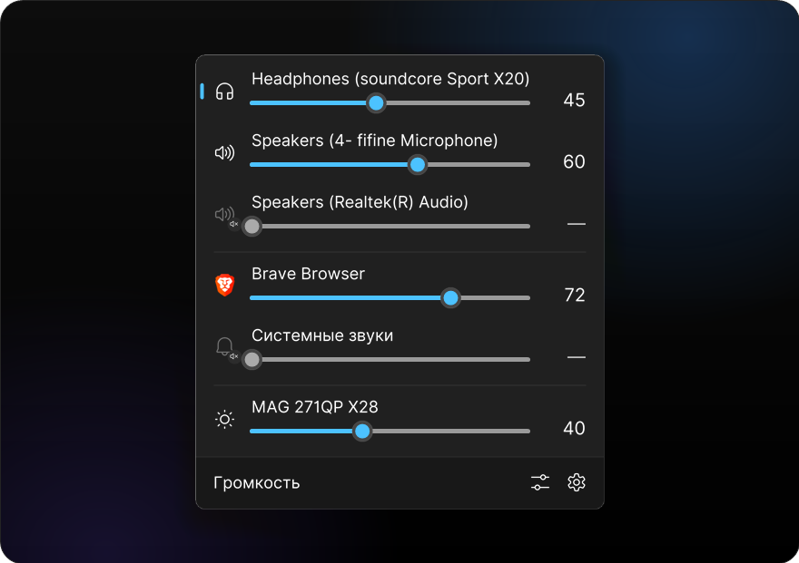

<div align="center">

[Русский](README.ru.md) · **English** · [Español](README.es.md) · [Português](README.pt.md) · [Deutsch](README.de.md) · [Français](README.fr.md) · [Italiano](README.it.md) · [Türkçe](README.tr.md) · [Українська](README.uk.md) · [Polski](README.pl.md)

<br>


<a href="https://github.com/sailxx/TrayMixer/releases/latest/download/TrayMixer-Setup.exe"></a>

</div>

<br>



The Windows 11 volume mixer is buried in Settings, and the tray volume icon controls just one device. **TrayMixer** is one click away: every pair of headphones, every speaker, every monitor and every app, each with its own slider. No ads, no background load.

<br>


<details>
<summary><b>Controls</b></summary>

| Action | Result |
|---|---|
| **Left-click** the tray icon | Open or close the flyout |
| **Middle-click** the tray icon | Mute or unmute the default device |
| **Right-click** the tray icon | Sound settings, Windows mixer, hidden rows, Mica/Acrylic, autostart, exit |
| Click a **row icon** | Mute or unmute |
| Click a **device name** | Make it the default device |
| **Right-click** a row | Hide it |
| **Mouse wheel** over a row | Volume or brightness ±2 |
| **Esc** or click outside | Close |

</details>

> [!NOTE]
> The TrayMixer interface and Setup are in English.

<br>


<br>



<details>
<summary><b>How to verify the installer was built from this code</b></summary>

Every release is built by GitHub Actions straight from source, and GitHub signs the build provenance:

```bash
gh attestation verify TrayMixer-Setup.exe --repo sailxx/TrayMixer
```

Each release contains only `TrayMixer-Setup.exe`. Its SHA-256 checksum is included in the release description:

```powershell
Get-FileHash .\TrayMixer-Setup.exe -Algorithm SHA256
```

</details>

## Install

1. Download [`TrayMixer-Setup.exe`](https://github.com/sailxx/TrayMixer/releases/latest/download/TrayMixer-Setup.exe) and run it.
2. Choose the install folder (default: `%LOCALAPPDATA%\TrayMixer`).
3. Setup installs the bundled app without an internet connection and creates desktop and Start menu shortcuts. Choose whether to enable autostart and launch the app.

To update, download Setup from the latest release and run it again. Setup offers **Update** for an older installation or **Reinstall** for the same version, preserves preferences and the autostart choice, and refuses to downgrade a newer installation. Remove TrayMixer through Windows Installed apps; preferences are kept.

Silent installation: `TrayMixer-Setup.exe /S /NOLAUNCH`. Optional: `/DIR="C:\path\TrayMixer"`, `/NOAUTOSTART`, `/LAUNCH`. Silent removal: `Uninstall.exe /uninstall /S`.

## Code signing policy

The installer and bundled app are **unsigned**. Windows SmartScreen may display a warning; verify the release source and checksum before running Setup.

GitHub Actions builds every release from source and publishes **build provenance** (SLSA level 1). Anyone can verify the artifact matches the source:

```bash
gh attestation verify TrayMixer-Setup.exe --repo sailxx/TrayMixer
```

## Build from source

Requires Windows with the .NET Framework 4.x C# compiler (included in Windows 11). No SDK or package downloads are needed.

```cmd
cd /d C:\path\to\TrayMixer
build.cmd
```

This builds the app locally and embeds it in `TrayMixer-Setup.exe`, the only release asset.

The installer source is in `installer/Setup.cs`.

## License

Apache-2.0 — see [`LICENSE`](LICENSE).