**English** · [العربية](README.ar.md) · [简体中文](README.zh-CN.md) · [繁體中文](README.zh-TW.md) · [Čeština](README.cs.md) · [Français](README.fr.md) · [Deutsch](README.de.md) · [Ελληνικά](README.el.md) · [Bahasa Indonesia](README.id.md) · [Gaeilge](README.ga.md) · [Italiano](README.it.md) · [日本語](README.ja.md) · [한국어](README.ko.md) · [Polski](README.pl.md) · [Română](README.ro.md) · [Русский](README.ru.md) · [Español](README.es.md) · [Українська](README.uk.md) · [اردو](README.ur.md) · [ئۇيغۇرچە](README.ug.md) · [Tiếng Việt](README.vi.md) · [Português](README.pt.md) · [Türkçe](README.tr.md)

<div align="center">


# TrayMixer

**Control the volume of every output and app from one small panel in your Windows 11 or Linux system tray.**

Turn down a game while keeping your call audible, switch between speakers and headphones, or adjust brightness, blue-light filtering and dimming on Windows.

**No telemetry or account.** Open source under Apache 2.0.


<br>


<a href="https://github.com/sailxx/TrayMixer/releases/download/v3.0.2/TrayMixer-Setup.exe"></a>&nbsp;&nbsp;<a href="https://github.com/sailxx/TrayMixer/releases/tag/linux-v3.1.1"></a>&nbsp;&nbsp;<a href="https://github.com/sailxx/TrayMixer/releases/download/v3.0.2/TrayMixer.exe"></a>&nbsp;&nbsp;<a href="https://github.com/sailxx/TrayMixer/releases"></a>

</div>

<br>


<details>
<summary><b>More about the features</b></summary>

### Outputs and app volume

Each output has its own slider and mute control. Click an output name to select it as the default. On Linux, this applies to new playback and each app stream appears separately.

### Windows display controls

Adjust brightness on supported monitors, warm the display with the blue-light filter, and use software dimming from the same mixer. [See the Windows screenshot at full size](assets/readme/screenshot.png).

### Tray controls

Left-click the Windows tray icon to show or hide the mixer and middle-click it to toggle mute on the default output. Scroll over a row to adjust it by two points, click an audio row’s icon to mute, or right-click a row to hide it. Restore hidden rows from the tray menu. Press <kbd>Esc</kbd> or click outside to close the Windows flyout. Linux tray clicks depend on your desktop.

### Appearance, startup and preferences

Windows uses a rounded flyout. Linux follows GNOME light, dark and accent colors or offers Charcoal, Nord, Catppuccin and Light. You can enable startup at login from the tray menu. Preferences are stored locally.

</details>

<br>


<br>



<br>


<br>


<details>
<summary><b>Install</b></summary>

### Windows 11 · x64 · v3.0.2

1. Download [**TrayMixer-Setup.exe**](https://github.com/sailxx/TrayMixer/releases/download/v3.0.2/TrayMixer-Setup.exe) for an offline installer or [**TrayMixer.exe**](https://github.com/sailxx/TrayMixer/releases/download/v3.0.2/TrayMixer.exe) to run the app directly.
2. In Setup, choose English or Russian, the install folder and whether to start TrayMixer at sign-in. The app interface is in English. Setup creates desktop and Start menu shortcuts.
3. Click the TrayMixer icon in the notification area to open the mixer.

Run Setup again to update or reinstall while keeping preferences and the autostart choice. Remove the app through Windows **Installed apps**.

The releases are unsigned, so Windows may show a SmartScreen warning. Compare the file’s SHA-256 with the [Windows release notes](https://github.com/sailxx/TrayMixer/releases/tag/v3.0.2).

For an unattended install without launching the app, run `TrayMixer-Setup.exe /S /NOLAUNCH` from the installer folder. Optional switches include `/DIR="C:\path\TrayMixer"`, `/NOAUTOSTART` and `/LAUNCH`. For unattended removal, run `Uninstall.exe /uninstall /S` from the installation folder, which defaults to `%LOCALAPPDATA%\TrayMixer`.

### Linux · x86_64 · v3.1.1 preview

| Package | Install or launch from the download folder |
| --- | --- |
| [DEB](https://github.com/sailxx/TrayMixer/releases/download/linux-v3.1.1/TrayMixer_3.1.1_amd64.deb) | `sudo apt install ./TrayMixer_3.1.1_amd64.deb` |
| [RPM](https://github.com/sailxx/TrayMixer/releases/download/linux-v3.1.1/TrayMixer-3.1.1-1.x86_64.rpm) | `sudo dnf install ./TrayMixer-3.1.1-1.x86_64.rpm` |
| [AppImage](https://github.com/sailxx/TrayMixer/releases/download/linux-v3.1.1/TrayMixer-3.1.1-x86_64.AppImage) | `chmod +x TrayMixer-3.1.1-x86_64.AppImage`, then `./TrayMixer-3.1.1-x86_64.AppImage` |

The preview uses X11 or XWayland and needs glibc 2.35+, PulseAudio 15+ or PipeWire-Pulse, and `pactl`. GNOME requires AppIndicator support for the tray icon. The AppImage needs system desktop libraries and accepts `--appimage-extract-and-run` if FUSE is unavailable.

See the [Linux guide](linux/README.md) for desktop requirements and tray behavior. Compare package hashes with [SHA256SUMS](https://github.com/sailxx/TrayMixer/releases/download/linux-v3.1.1/SHA256SUMS).

</details>

<a id="platforms"></a>

<details>
<summary><b>Platforms and known limits</b></summary>

| | Windows 11 | Linux preview |
| --- | --- | --- |
| Audio | Device and grouped app volume | Devices and individual app streams via PulseAudio or PipeWire-Pulse |
| Tray | Windows notification area | Depends on the desktop tray host |
| Display | Brightness, blue-light filtering and dimming | Opens the desktop’s display and night light settings |
| Preferences | `HKCU\Software\TrayMixer` | `$XDG_CONFIG_HOME/traymixer/settings.json` |

Monitor and driver support affect brightness on Windows. Linux packaging and startup are checked on Ubuntu 24.04. Fedora and Debian installations, GNOME tray behavior and hardware compatibility still need desktop testing.

</details>

<details>
<summary><b>Development</b></summary>

TrayMixer is maintained by [Vlad (sailxx)](https://github.com/sailxx) under the [Apache License 2.0](LICENSE).

Build Windows from a clone with the built-in .NET Framework C# compiler.

```cmd
build.cmd
```

Build Linux with .NET SDK 10.0. See the [Linux build and packaging guide](linux/README.md#build-and-verify).

```sh
dotnet build linux/TrayMixer.Linux.csproj -c Release
dotnet run --project linux/tests/TrayMixer.Linux.Tests.csproj -c Release
```

To rebuild the English README artwork, use the Golos Text and JetBrains Mono fonts in `tools/readme/.font` as described in [build.mjs](tools/readme/build.mjs).

```sh
cd tools/readme
npm ci
node build.mjs --showcase
```

To verify a download, use `Get-FileHash .\TrayMixer-Setup.exe -Algorithm SHA256` in PowerShell and compare with the [Windows release notes](https://github.com/sailxx/TrayMixer/releases/tag/v3.0.2), or use `sha256sum <filename>` on Linux and compare with [SHA256SUMS](https://github.com/sailxx/TrayMixer/releases/download/linux-v3.1.1/SHA256SUMS).

TrayMixer stores preferences locally. Linux sends audio commands to your configured PulseAudio or PipeWire-Pulse server. See the [privacy policy](PRIVACY.md) and [security policy](SECURITY.md). For a reproducible bug, include the version, OS, desktop and affected hardware in a [GitHub issue](https://github.com/sailxx/TrayMixer/issues).

</details>

---

<div align="center">


Translations may describe earlier releases.

</div>
