<div align="center">

[Русский](README.ru.md) · **English** · [Español](README.es.md) · [Português](README.pt.md) · [Deutsch](README.de.md) · [Français](README.fr.md) · [Italiano](README.it.md) · [Türkçe](README.tr.md) · [Українська](README.uk.md) · [Polski](README.pl.md)


# TrayMixer

**Actively in development. A stable Windows release is already available.**

### Your audio. One click away.

A compact mixer in your system tray: adjust output devices and application volume without digging through system settings. On Windows, brightness, blue-light filtering and dimming live in the same panel.

Built and continuously improved by **Vlad · [sailxx](https://github.com/sailxx)**.

[](https://github.com/sailxx/TrayMixer/releases/tag/v3.0.1)
[](https://github.com/sailxx/TrayMixer/releases/tag/linux-v3.1.1)
[](LICENSE)


[](https://github.com/sailxx/TrayMixer/releases/download/v3.0.1/TrayMixer-Setup.exe)
[](https://github.com/sailxx/TrayMixer/releases/tag/linux-v3.1.1)
[](https://github.com/sailxx/TrayMixer/releases)

Windows 11 · English interface · Linux x86_64 preview: DEB, RPM and AppImage

[Features](#features) · [Install](#install) · [Controls](#controls) · [Roadmap](#roadmap) · [Trust](#privacy--security) · [About](#about-traymixer)

</div>

## Features

<p align="center">






</p>

Turn down a game without losing your call, switch from speakers to headphones, or dim a bright screen in the evening. TrayMixer brings these frequent adjustments closer; it is not a replacement for every system audio or display setting.

### What you can do

| Sound, within reach | A panel that fits your desktop |
|---|---|
| **Output devices** — separate volume and mute controls; click a device name to make it the default. | **Windows 11** — a compact native flyout with rounded corners. |
| **Application volume** — turn down a browser, game or call without changing everything else. | **Linux themes** — follow GNOME light/dark and accent colors, or choose Charcoal, Nord, Catppuccin or Light. |
| **Less clutter** — hide rows you do not need and restore them from the tray menu. | **Display controls on Windows** — brightness, blue-light filtering and software dimming alongside your audio. |
| **Quick adjustments** — mute from a row icon or use the mouse wheel to change a value. | **Start at login** — choose whether TrayMixer opens with your desktop. |

> **Linux is a separate preview, not full Windows parity.** It uses Avalonia and PulseAudio / PipeWire-Pulse, shows individual application streams rather than grouped sessions, and opens desktop display settings instead of providing integrated brightness, blue-light and dimming sliders. It does not use Mica. [Requirements and known limitations](linux/README.md).

## Install

### Windows 11

1. Download [**TrayMixer-Setup.exe**](https://github.com/sailxx/TrayMixer/releases/download/v3.0.1/TrayMixer-Setup.exe).
2. Select English or Russian in the installer, then choose the install folder. The default is `%LOCALAPPDATA%\TrayMixer`; the app itself stays in English.
3. Setup installs offline and creates desktop and Start menu shortcuts. Choose whether to enable autostart and launch the app.

Run Setup again to update or reinstall. Preferences and the autostart choice are preserved; downgrades are refused. Remove TrayMixer through Windows **Installed apps**.

The installer and app are currently **unsigned**. Windows may show a SmartScreen warning. Check the release source and SHA-256 before deciding whether to run the download; see [verification](#build-and-verification).

<details>
<summary><strong>Silent installation and removal</strong></summary>

From the folder containing the downloaded installer:

```cmd
cd /d "%USERPROFILE%\Downloads"
TrayMixer-Setup.exe /S /NOLAUNCH
```

Optional switches: `/DIR="C:\path\TrayMixer"`, `/NOAUTOSTART`, `/LAUNCH`.

For the default installation folder, silent removal is:

```cmd
cd /d "%LOCALAPPDATA%\TrayMixer"
Uninstall.exe /uninstall /S
```

If you chose a different folder, use that folder instead.

</details>

### Linux · x86_64 preview

| Format | Download | Install |
|---|---|---|
| **DEB** · Ubuntu / Debian-compatible | [TrayMixer_3.1.1_amd64.deb](https://github.com/sailxx/TrayMixer/releases/download/linux-v3.1.1/TrayMixer_3.1.1_amd64.deb) | Software installer or `apt` |
| **RPM** · Fedora-compatible | [TrayMixer-3.1.1-1.x86_64.rpm](https://github.com/sailxx/TrayMixer/releases/download/linux-v3.1.1/TrayMixer-3.1.1-1.x86_64.rpm) | Software installer or `dnf` |
| **AppImage** · portable | [TrayMixer-3.1.1-x86_64.AppImage](https://github.com/sailxx/TrayMixer/releases/download/linux-v3.1.1/TrayMixer-3.1.1-x86_64.AppImage) | Make executable and launch |

Requires x86_64 Linux, glibc 2.35+, X11 / XWayland, PulseAudio 15+ or PipeWire-Pulse, and `pactl`. Build and package checks use Ubuntu 24.04; distribution-specific desktop testing on Fedora and Debian is still needed.

> **GNOME tray:** enable an AppIndicator / StatusNotifier extension. Ubuntu normally includes one. No extension is installed automatically. Without a working tray host, avoid tray-only autostart; launch TrayMixer from the application menu to reopen the mixer.

<details>
<summary><strong>Ubuntu / Debian-compatible installation</strong></summary>

```sh
mkdir -p "$HOME/Downloads/TrayMixer"
cd "$HOME/Downloads/TrayMixer"
curl -fLO https://github.com/sailxx/TrayMixer/releases/download/linux-v3.1.1/TrayMixer_3.1.1_amd64.deb
sudo apt install ./TrayMixer_3.1.1_amd64.deb
traymixer
```

</details>

<details>
<summary><strong>Fedora-compatible installation</strong></summary>

For conventional Fedora installations using `dnf`:

```sh
mkdir -p "$HOME/Downloads/TrayMixer"
cd "$HOME/Downloads/TrayMixer"
curl -fLO https://github.com/sailxx/TrayMixer/releases/download/linux-v3.1.1/TrayMixer-3.1.1-1.x86_64.rpm
sudo dnf install ./TrayMixer-3.1.1-1.x86_64.rpm
traymixer
```

</details>

<details>
<summary><strong>AppImage — portable installation</strong></summary>

Install `pulseaudio-utils` using your distribution's package manager first. The AppImage bundles .NET, but still requires system `pactl`, X11 / XWayland libraries, fontconfig, ICU and OpenSSL.

```sh
mkdir -p "$HOME/Applications"
cd "$HOME/Applications"
curl -fLO https://github.com/sailxx/TrayMixer/releases/download/linux-v3.1.1/TrayMixer-3.1.1-x86_64.AppImage
chmod +x TrayMixer-3.1.1-x86_64.AppImage
./TrayMixer-3.1.1-x86_64.AppImage
```

If FUSE is unavailable, run `./TrayMixer-3.1.1-x86_64.AppImage --appimage-extract-and-run` instead. Keep the file in its permanent location before enabling **Start at login**.

</details>

## Controls

<details>
<summary><strong>Windows — tray and panel shortcuts</strong></summary>

| Action | Result |
|---|---|
| Left-click tray icon | Open / close the flyout |
| Middle-click tray icon | Mute / unmute default output |
| Right-click tray icon | Settings, hidden rows, appearance, autostart, exit |
| Click row icon | Mute / unmute |
| Click device name | Make default |
| Right-click row | Hide |
| Mouse wheel over row | Volume or brightness ±2 |
| Esc / click outside | Close |

</details>

<details>
<summary><strong>Linux — tray, audio and themes</strong></summary>

- Tray activation toggles the mixer. The menu includes Open mixer, default-output mute, Restore hidden rows, autostart and Exit. Click behavior depends on the desktop tray host.
- Adjust output and application-stream volume, mute, or use the mouse wheel. Right-click a row to hide it.
- Click an output name to make it the default for new playback. Streams already playing are not forcibly moved.
- **GNOME / System** follows desktop light/dark and GNOME accent colors. **Charcoal**, **Nord**, **Catppuccin** and **Light** provide alternative palettes.
- **Display & night light settings** opens desktop settings; integrated Windows display controls are not yet ported.

[Full Linux documentation](linux/README.md)

</details>

## Build and verification

<details>
<summary><strong>Build from source</strong></summary>

**Windows:** from your clone, run `build.cmd`. It uses the .NET Framework C# compiler included with Windows 11 to build the application executable.

```cmd
cd /d C:\path\to\TrayMixer
build.cmd
```

Replace `C:\path\to\TrayMixer` with your clone's location. This command builds the app, not the release installer.

**Linux:** requires .NET SDK 10.0. See [build instructions and checks](linux/README.md#build-and-verify). The Linux workflow builds DEB, RPM and AppImage packages and runs PulseAudio and startup smoke checks. These do not replace real GNOME desktop testing.

Windows and Linux have separate release streams.

</details>

<details>
<summary><strong>Verify a download</strong></summary>

**Windows:** download from the [Windows release](https://github.com/sailxx/TrayMixer/releases/tag/v3.0.1). In PowerShell, calculate the installer's SHA-256 and compare the entire value with the release description:

```powershell
cd "$HOME\Downloads"
Get-FileHash .\TrayMixer-Setup.exe -Algorithm SHA256
```

Do not run a file if its checksum differs. A matching checksum confirms that it matches the published file, not that the software is free of vulnerabilities. For Windows 3.0.1, verify the provenance of the exact file with `gh attestation verify <filename> --repo sailxx/TrayMixer`.

**Linux:** download `SHA256SUMS` from the [Linux release](https://github.com/sailxx/TrayMixer/releases/tag/linux-v3.1.1), then compare your package with its corresponding entry using `sha256sum <filename>`.

The Windows installer and application are unsigned; Linux packages are also unsigned. Build provenance and checksums are not code-signing certificates.

</details>

## Roadmap


- **1.0 · October 6, 2026** — TrayMixer started as a lightweight Windows 11 volume mixer that opened from the system tray.
- **2.x** — Display brightness joined the audio controls. Blue-light filtering, dimming and a Windows installer followed.
- [**Windows 3.0**](https://github.com/sailxx/TrayMixer/releases/tag/v3.0.0) — The flyout gained a subtler glass backdrop and smoother resizing.
- [**Linux 3.1**](https://github.com/sailxx/TrayMixer/releases/tag/linux-v3.1.0) — The first Linux preview brought tray audio controls, GNOME-aware themes and DEB, RPM and AppImage packages.
- [**Windows 3.0.1**](https://github.com/sailxx/TrayMixer/releases/tag/v3.0.1) and [**Linux 3.1.1**](https://github.com/sailxx/TrayMixer/releases/tag/linux-v3.1.1) — The current stable Windows release and Linux preview.

Next up is testing the Linux preview on more desktops and hardware. Integrated Linux display controls are an idea to explore as desktop support allows.

## Privacy & security

<p align="center">



</p>

### What stays on your computer

TrayMixer has no account system, advertising or application analytics. The application source has no built-in internet service or telemetry client. It reads audio device and application information to label the mixer, and stores preferences and hidden-row identifiers locally. Downloading releases, restoring build dependencies and visiting GitHub are separate online activities.

- **Windows:** preferences live under `HKCU\Software\TrayMixer`; autostart uses the current user's Windows Run key. The app uses Windows audio and display interfaces. Its manifest requests `asInvoker`, so it does not request elevation itself; it inherits the privileges of the process that launches it.
- **Linux:** preferences live in `$XDG_CONFIG_HOME/traymixer/settings.json` (normally `~/.config/traymixer/settings.json`). Optional autostart uses `$XDG_CONFIG_HOME/autostart/traymixer.desktop`. Audio commands go through your configured PulseAudio / PipeWire-Pulse server via `pactl`; a user-configured remote audio server is not ruled out. Installing DEB / RPM packages may require administrator privileges, unlike normal app use.

The [privacy policy](PRIVACY.md) currently describes Windows. The Linux storage and audio-server details above supplement it; do not assume Windows registry cleanup instructions apply to Linux.

### What makes the project inspectable

The source is public under Apache 2.0, and you can inspect changes, report problems or build it yourself. Windows restricts native DLL lookup to System32 to reduce DLL-planting risk. The Linux command runner passes arguments separately rather than through a shell and limits command execution time. These measures reduce specific risks; they are not a guarantee of complete security.

Release binaries are currently documented as **unsigned**. A SmartScreen warning is possible on Windows. Always use this repository's release pages, compare checksums and read the [download verification instructions](#build-and-verification). Checksums and build provenance are not substitutes for code signing or an independent security review. No independent security audit is claimed here.

Please report vulnerabilities privately through [GitHub Security Advisories](https://github.com/sailxx/TrayMixer/security/advisories/new), not in a public issue. See the [security policy](SECURITY.md).

## Reliability & current limits

TrayMixer is actively maintained, but stable does not mean bug-free on every device. The repository includes Windows build checks and a Linux workflow for regression tests, PulseAudio readback, package metadata and startup smoke checks. A configured workflow is not proof that every release has passed every check, and automated checks do not replace real desktop or hardware testing.

Windows brightness depends on monitor and driver support; blue-light and dimming behavior can vary with display configuration. Linux remains a preview: tray integration depends on the desktop host, GNOME may need an extension, and display controls currently open system settings. Keep system settings available as a fallback. There are no universal performance or compatibility guarantees.

For a useful bug report, include the app version, OS / desktop version, affected audio or display device, what you expected and the steps to reproduce. Redact private paths, application names and other personal information from screenshots or logs.

## About TrayMixer


[Vlad (sailxx)](https://github.com/sailxx) started TrayMixer on **October 6, 2026** to put everyday sound controls one click away. It is free, open source and independently maintained.

There are no accounts, ads or trackers. TrayMixer reads device and app names to fill the mixer and keeps your preferences on your computer. It does not send usage data. [Privacy policy](PRIVACY.md)

[](https://github.com/sailxx/TrayMixer/issues)

You can help by reporting bugs, testing the Linux preview on your desktop, improving documentation or proposing a focused pull request. Do not include credentials or private data in reports.

## License

[Apache License 2.0](LICENSE).

---

<div align="center">

Translations are available separately and may not yet reflect the latest platform changes.

</div>
