<div align="center">

**Русский** · [English](README.en.md) · [Español](README.es.md) · [Português](README.pt.md) · [Deutsch](README.de.md) · [Français](README.fr.md) · [Italiano](README.it.md) · [Türkçe](README.tr.md) · [Українська](README.uk.md) · [Polski](README.pl.md)

<br>



<a href="https://github.com/sailxx/TrayMixer/releases/latest/download/TrayMixer.exe"></a>

</div>

<br>


Стандартный микшер Windows 11 спрятан в «Параметрах», а значок громкости в трее меняет только одно устройство. **TrayMixer** — один клик по значку, и перед вами все наушники, колонки, мониторы и каждое приложение со своим ползунком. Без установки, без рекламы, без фоновой нагрузки.

<br>



<details>
<summary><b>Управление</b></summary>

| Действие | Результат |
|---|---|
| **Левый клик** по значку в трее | Открыть или закрыть окно |
| **Средний клик** по значку | Выключить или включить звук основного устройства |
| **Правый клик** по значку | Параметры звука, микшер Windows, скрытые строки, фон Mica/Acrylic, автозапуск, выход |
| Клик по **иконке строки** | Выключить или включить звук, фильтр синего света или затемнение |
| Клик по **названию устройства** | Сделать его основным |
| **Правый клик** по строке | Скрыть её |
| **Колёсико мыши** над строкой | Громкость, яркость, сила фильтра или затемнение ±2 |
| **Esc** или клик мимо окна | Закрыть |

</details>

<br>



<br>



<details>
<summary><b>Как проверить, что exe собран из этого кода</b></summary>

Каждый релиз собирает GitHub Actions прямо из исходников, а GitHub подписывает происхождение файла (build provenance). Проверить можно так:

```bash
gh attestation verify TrayMixer.exe --repo sailxx/TrayMixer
```

Контрольная сумма SHA-256 лежит рядом с exe в каждом релизе (`TrayMixer.exe.sha256`):

```powershell
Get-FileHash .\TrayMixer.exe -Algorithm SHA256
```

</details>

## Установка

1. Скачайте [`TrayMixer.exe`](https://github.com/sailxx/TrayMixer/releases/latest/download/TrayMixer.exe) и положите в постоянную папку, например `%LOCALAPPDATA%\TrayMixer`.
2. Запустите. Значок появится в трее, автозапуск включится сам (выключается в меню).

## Code signing policy

Free code signing provided by [SignPath.io](https://signpath.io), certificate by [SignPath Foundation](https://signpath.org).

- **What is signed:** only the official `TrayMixer.exe` that GitHub Actions builds from this repository when a `v*` tag is pushed (see `.github/workflows/release.yml`). Builds from forks, branches or local machines are never signed.
- **Team roles:** committer, reviewer and approver of every signing request — [@sailxx](https://github.com/sailxx). Two-factor authentication is required for the GitHub and SignPath accounts.
- **Privacy:** this program will not transfer any information to other networked systems unless specifically requested by the user or the person installing or operating it.
- **Verification:** besides the signature, every release carries a SHA-256 file and a GitHub build provenance attestation (`gh attestation verify TrayMixer.exe --repo sailxx/TrayMixer`).
