<div align="center">

**Русский** · [English](README.md) · [Español](README.es.md) · [Português](README.pt.md) · [Deutsch](README.de.md) · [Français](README.fr.md) · [Italiano](README.it.md) · [Türkçe](README.tr.md) · [Українська](README.uk.md) · [Polski](README.pl.md)

<br>



<a href="https://github.com/sailxx/TrayMixer/releases/latest/download/TrayMixer-Setup.exe"></a>

</div>

<br>


Стандартный микшер Windows 11 спрятан в «Параметрах», а значок громкости в трее меняет только одно устройство. **TrayMixer** — один клик по значку, и перед вами все наушники, колонки, мониторы и каждое приложение со своим ползунком. Без установки, без рекламы, без фоновой нагрузки.

<br>


<details>
<summary><b>Управление</b></summary>

| Действие | Результат |
|---|---|
| **Левый клик** по значку в трее | Открыть или закрыть окно |
| **Средний клик** по значку | Выключить или включить звук основного устройства |
| **Правый клик** по значку | Параметры звука, микшер Windows, скрытые строки, фон Mica/Acrylic, автозапуск, выход |
| Клик по **иконке строки** | Выключить или включить звук, фильтр синего света или затемнение |
| Клик по **названию устройства** | Сделать его основным |
| **Правый клик** по строке | Скрыть её |
| **Колёсико мыши** над строкой | Громкость, яркость, сила фильтра или затемнение ±2 |
| **Esc** или клик мимо окна | Закрыть |

</details>

<br>



<br>


<details>
<summary><b>Как проверить, что exe собран из этого кода</b></summary>

Каждый релиз собирает GitHub Actions прямо из исходников, а GitHub подписывает происхождение файла (build provenance). Проверить можно так:

```bash
gh attestation verify TrayMixer-Setup.exe --repo sailxx/TrayMixer
```

Контрольная сумма SHA-256 установщика указана в описании каждого релиза:

```powershell
Get-FileHash .\TrayMixer-Setup.exe -Algorithm SHA256
```

</details>

## Установка

1. Скачайте [`TrayMixer-Setup.exe`](https://github.com/sailxx/TrayMixer/releases/latest/download/TrayMixer-Setup.exe) и запустите.
2. Выберите папку (по умолчанию `%LOCALAPPDATA%\TrayMixer`), автозапуск и запуск после установки. Ярлыки на рабочем столе и в меню «Пуск» создаются автоматически. Интернет для установки не нужен.
3. Для обновления запустите Setup нового релиза; для переустановки — той же версии. Настройки сохраняются, установка более старой версии блокируется. Удаление доступно в списке установленных приложений Windows; настройки сохраняются.

В релизе публикуется только `TrayMixer-Setup.exe`; SHA-256 указан в описании релиза.

## Подпись и проверка

Установщик и встроенное приложение не имеют цифровой подписи. Windows SmartScreen может показать предупреждение; перед запуском проверьте источник релиза и контрольную сумму.

GitHub Actions собирает релизы из исходников и публикует подтверждение происхождения сборки (`gh attestation verify TrayMixer-Setup.exe --repo sailxx/TrayMixer`). SHA-256 указан в описании релиза.
