<div align="center">

[Русский](README.ru.md) · [English](README.md) · [Español](README.es.md) · [Português](README.pt.md) · [Deutsch](README.de.md) · [Français](README.fr.md) · [Italiano](README.it.md) · [Türkçe](README.tr.md) · **Українська** · [Polski](README.pl.md)

<br>



<a href="https://github.com/sailxx/TrayMixer/releases/latest/download/TrayMixer.exe"></a>

</div>

<br>


Стандартний мікшер Windows 11 захований у «Параметрах», а значок гучності в треї змінює лише один пристрій. **TrayMixer** — один клік по значку, і перед вами всі навушники, колонки, монітори та кожен застосунок зі своїм повзунком. Без встановлення, без реклами, без фонового навантаження.

<br>



<details>
<summary><b>Керування</b></summary>

| Дія | Результат |
|---|---|
| **Лівий клік** по значку в треї | Відкрити або закрити вікно |
| **Середній клік** по значку | Вимкнути або ввімкнути звук основного пристрою |
| **Правий клік** по значку | Параметри звуку, мікшер Windows, приховані рядки, фон Mica/Acrylic, автозапуск, вихід |
| Клік по **іконці рядка** | Вимкнути або ввімкнути звук |
| Клік по **назві пристрою** | Зробити його основним |
| **Правий клік** по рядку | Приховати його |
| **Коліщатко миші** над рядком | Гучність або яскравість ±2 |
| **Esc** або клік повз вікно | Закрити |

</details>

> [!NOTE]
> Інтерфейс TrayMixer — російською мовою.

<br>



<br>



<details>
<summary><b>Як перевірити, що exe зібрано з цього коду</b></summary>

Кожен реліз збирає GitHub Actions просто з вихідного коду, а GitHub підписує походження файлу (build provenance). Перевірити можна так:

```bash
gh attestation verify TrayMixer.exe --repo sailxx/TrayMixer
```

Контрольна сума SHA-256 лежить поруч з exe у кожному релізі (`TrayMixer.exe.sha256`):

```powershell
Get-FileHash .\TrayMixer.exe -Algorithm SHA256
```

</details>

## Встановлення

1. Завантажте [`TrayMixer.exe`](https://github.com/sailxx/TrayMixer/releases/latest/download/TrayMixer.exe) і покладіть у постійну папку, наприклад `%LOCALAPPDATA%\TrayMixer`.
2. Запустіть. Значок з’явиться в треї, автозапуск увімкнеться сам (вимикається в меню).

## Code signing policy

Free code signing provided by [SignPath.io](https://signpath.io), certificate by [SignPath Foundation](https://signpath.org).

- **What is signed:** only the official `TrayMixer.exe` that GitHub Actions builds from this repository when a `v*` tag is pushed (see `.github/workflows/release.yml`). Builds from forks, branches or local machines are never signed.
- **Team roles:** committer, reviewer and approver of every signing request — [@sailxx](https://github.com/sailxx). Two-factor authentication is required for the GitHub and SignPath accounts.
- **Privacy:** this program will not transfer any information to other networked systems unless specifically requested by the user or the person installing or operating it.
- **Verification:** besides the signature, every release carries a SHA-256 file and a GitHub build provenance attestation (`gh attestation verify TrayMixer.exe --repo sailxx/TrayMixer`).
